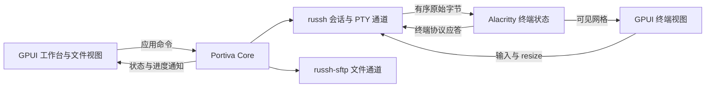

**Portiva2：Rust + GPUI 复刻 SSH / SFTP 的可行性与实现方案**

调研日期：2026-11-27，Asia/Singapore。参考项目：`D:\gshu\Portiva`，源码提交 `59e1e33`，应用清单版本 `1.15.0`。本文首先记录源码分析与选型，后续已开始实现。当前状态与运行方式见 `README.md`：独立核心库、GPUI 工作台、SSH PTY 和 SFTP 传输已打通，核心测试及 Windows 可见回环窗口已验证；全文中的完整复刻目标仍需逐项验收。

**判断与建议**

可行。建议复用现有 Rust 协议及业务代码，用 GPUI 重建桌面界面，并采用成熟终端内核。主要新增工作是终端视图和桌面交互适配，以及把当前散落在 Tauri 命令和 React 中的业务调度迁回 Rust。

推荐组合为：GPUI + Longbridge GPUI Kit（包含 gpui-component）+ alacritty_terminal + Tokio + russh + russh-sftp。首轮先完成 Windows 上的真实 SSH 终端和 SFTP 纵向原型，再展开界面复刻。跨平台目标可沿用 Windows x64、Linux x64、macOS Apple Silicon，各平台交互需要分别验证。

协议、文件操作、凭据保护、终端解析和常用控件均使用已有实现；自行维护的范围集中在 Portiva 的工作台编排、业务状态与 GPUI 适配。暂时无法给出可信的代码复用百分比或性能提升数字。

**当前源码中实际存在的功能**

| 范围 | 已找到的实现和交互 | 迁移处理 |
| --- | --- | --- |
| 连接管理 | SSH / SFTP 配置、分组与最近连接；测试、保存、连接；密码、私钥与 agent 认证 | 复用 Rust 模型和存储，重建表单、验证反馈与连接状态 |
| 主机身份 | 首次指纹确认、已知指纹检查、变化提示与信任记录 | 保留可信主机判断流程；未确认前不得继续认证 |
| SSH 会话 | PTY、输入输出、resize、keepalive、断开提示、重连 | 复用 russh 会话逻辑，替换 Tauri 状态获取、任务启动与事件分发 |
| SSH 工作台 | 多标签、排序、关闭与重连；最多四个终端的左右 / 上下分屏、聚焦与比例拖动 | GPUI 标签、可调整面板与应用状态实现 |
| SSH 辅助面板 | 可开关命令助手、SFTP 栏、底部状态；常用命令、命令历史、主机概览 | 保留行为，按需移植采集和持久化逻辑 |
| 终端体验 | xterm.js 搜索、历史滚动、选择复制、右键交互、中文输入适配、语义高亮与序列化恢复 | xterm.js 专属代码需要重写；以功能验收决定替代完成度 |
| SFTP 侧栏 | 左右换边、宽度调整、路径输入、刷新、目录进入、多选、右键、行内重命名、新建与删除确认 | 复用文件操作服务，重建列表和事件交互 |
| 独立 SFTP | 本地 / 远程双栏、路径导航、本地磁盘、文件属性显示、上传下载、队列高度调整 | 共享文件列表与队列组件，组合成独立文件页 |
| 目录传输 | Rust 负责递归上传；React 的 queueDownloadDirectory 负责递归遍历远端目录并创建本地目录、逐文件入队 | 两种调度统一放入 Rust 核心，不能只复制现有 services 目录 |
| 传输任务 | 文件 / 目录 / 批量上传，下载入队；进度、速度、暂停、继续、取消、重试、冲突等待、部分成功 | 复用任务模型及状态转换；保留临时文件与完成后落盘逻辑 |
| 外部文件拖入 | Tauri 拖放事件触发上传 | 改接 GPUI 的平台文件拖入入口，验证 Windows 文件管理器真实拖放 |
| 多窗口 | 标签分离到独立窗口及合并回主窗口 | 多窗口共享同一会话和终端状态，重新实现窗口及焦点管理 |
| X11 | 独立的 X11 转发服务、可用性检测与终端开关 | 可迁移，置于基础终端与 SFTP 验收之后 |

界面应以当前源码中的主题颜色、字号、控件尺寸和面板行为为对照。CSS 和 React 组件不能直接运行于 GPUI；可迁移的是设计参数、文案和交互规则。

**容易误判的现状**

1. 普通 SSH 端口转发尚未真正接入。`tunnel_service.rs` 的 start / stop 仍有 TODO，只修改规则状态。capability 字段中标记为 true 不能作为已实现证据。X11 转发有独立实现，应区别对待。
2. 暂停 / 继续是在运行中的拷贝任务内等待和恢复；不能据此声称支持应用退出、网络断开后按文件偏移续传。持久化断点恢复应作为独立需求。
3. `TransferConflictPolicy` 虽有 Rename 枚举，当前冲突执行分支明确返回不支持；复刻基线采用已接通的覆盖、全部覆盖、跳过、全部跳过。
4. 单文件下载服务会拒绝目录，但目录下载的上层遍历在 React 中，整体产品仍有目录下载流程。迁移时需沿完整调用链处理。
5. SFTP 文件读写和目录操作共用 `Arc<AsyncMutex<SftpSession>>`，文件拷贝期间持续持锁。由此推断，大文件传输及暂停期间可能拖住目录浏览；实际影响还需测量。队列的默认上限、SFTP 调度的单次启动限制、会话锁也必须一起看，不能仅凭某个常量判断真实并发度。
6. 配置主要位于用户目录 `.portiva` 下的 JSON 文件；常用命令和部分面板偏好则在 WebView localStorage。SSH / SFTP 配置迁移不需要先引入数据库。

上述判断来自本地源码，不依赖 README 中的功能概述。

**开源库选择**

| 部分 | 建议 | 原因及边界 |
| --- | --- | --- |
| 桌面 UI | GPUI，通过 GPUI Kit 配套引入 | Rust 原生 GPU UI；Windows / Linux / macOS 的最终体验逐平台验收 [W1][W2] |
| 基础组件 | Longbridge GPUI Kit / gpui-component | 表单、菜单、对话框、虚拟列表 / 表格、标签和可调整布局可以复用；软件源码为 Apache-2.0 [W2] |
| 终端内核 | alacritty_terminal | 复用终端状态与控制序列解析；该 crate 为 Apache-2.0，适合嵌入终端产品；它不提供现成 GPUI 视图 [W3] |
| SSH | 保留 russh | 当前已使用，Tokio 异步协议库；无需为改 UI 更换协议实现 [W4] |
| SFTP | 保留 russh-sftp | 当前已使用，提供 SFTP 子系统与文件访问；队列和产品交互继续由 Portiva 的业务层管理 [W5] |
| 异步任务 | 保留 Tokio，配合有界消息通道 | SSH / 文件 I/O 在运行时执行，GPUI 只消费状态通知 |
| 配置 | 保留 serde / serde_json 与现有 JSON 存储 | 容易移植及兼容原有配置，暂不增加 ORM 或迁移框架 |
| 凭据 | 复用现有 keyring + ring 方案 | 当前实现以系统凭据库中的主密钥保护本地凭据密文；迁移需保留格式和密钥访问语义 |
| 剪贴板 | 优先 GPUI 已有接口，缺口再复用 arboard | 避免两套剪贴板处理规则 |
| 文件选择 / 打开目录 | 优先 GPUI 平台接口，缺口再接 rfd / opener 等适配库 | 在原型阶段按真实平台能力决定，不预先堆依赖 |

本地锁定的协议依赖是 russh `0.60.2`、russh-sftp `2.1.2`。这是旧项目当前的构建基线，不代表上游最新版。迁移阶段先保留协议行为；另行核对这些版本的兼容性、安全公告及升级需求。

GPUI Kit 当前官方仓库由旧地址 `longbridge/gpui-component` 跳转至 `longbridge/gpui-kit`，其中仍包含 gpui-component。官方建议入口会固定匹配的 GPUI 并重新导出相关类型。新工程应选择一套发布组合、记录 Cargo.lock，避免把上游 git main、不同快照及旧 crate 混用。[W2]

此阶段不确定最终 Cargo.toml 的全部版本号；需要以 Windows 上编译、运行和终端交互验证通过的组合为准。

**终端方案的取舍**

终端是本项目的主要不确定性：文字显示只是其中一部分，鼠标选区、历史滚动、IME、全屏缓冲、按键编码、终端应答及 PTY resize 必须形成完整链路。

| 路线 | 评价 | 建议 |
| --- | --- | --- |
| alacritty_terminal + 自有 GPUI 终端适配模块 | 内核成熟，渲染和输入接入由本项目负责；工作量集中在有限模块 | 推荐作为可控的实现基线 |
| 直接采用 zortax/gpui-terminal | 已发布的 0.1.0 使用 Alacritty 内核，可用于概念验证；文档明确缺少鼠标文字选择与历史滚动导航，依赖 gpui 0.2.2 | 作为候选或参考，不能直接承诺达到旧版体验 [W6] |
| 直接移入 Zed terminal crate | 是现有集成实例，但依赖 Zed 的多项内部模块；terminal crate 标为 GPL-3.0-or-later，和 GPUI 本身的许可不同 | 不作为 Portiva2 的默认依赖；技术参考和代码移植需区分 [W7] |
| 继续嵌入 WebView + xterm.js | 保留已有终端能力，但引入两套 UI、焦点、输入法及窗口集成 | 用户要求 Rust + GPUI 的目标下，不列为首选 |

“使用 Alacritty 内核”不等于重写终端模拟器。项目只实现把内核接到 GPUI 与 SSH 的适配层：可见网格绘制、字符坐标与鼠标命中、键盘 / IME 输入、剪贴板、主题、搜索 UI，以及终端事件回传。

若候选开源组件在验证时已补齐能力，应优先复用其合适的发布版；记录实际版本与结果。不要为了适配一个不完整组件，把整个 UI 固定在过旧的 GPUI 上。

**建议的工程结构**

初期使用两个 workspace 成员即可：

```text
Portiva2/
  Cargo.toml
  crates/
    portiva-core/       SSH、SFTP、传输调度、配置与凭据、领域模型
    portiva-desktop/    GPUI 工作台、界面状态、terminal 适配模块、平台操作
  docs/
```

核心层不依赖 GPUI 或 Tauri。终端适配先作为 desktop 内的模块，确定独立复用需要后再拆 crate。只迁移本轮 SSH / SFTP 所需部分，不先搭建插件系统或多协议抽象框架。



原生 UI 直接调用 Rust 应用服务，不再经过 JavaScript invoke、JSON 字节流或 Tauri 全局事件。应用命令和领域通知采用具体类型；无需为单个应用搭建通用事件总线。

Tokio 使用一个长期运行的运行时。GPUI 界面线程只进行状态更新和绘制；SSH、目录扫描、传输、文件 I/O、凭据访问放到适当的异步或阻塞任务。任务完成后通知视图，不从 Tokio 工作线程直接修改 GPUI 实体。

输出按顺序进入终端解析器，通知可以合并，终端字节不能丢弃。网络输出保留原始字节；终端解析器处理跨包 UTF-8 和控制序列。进度采用有界通道或最新快照，合并频繁刷新，避免队列随输出无限增长。隐藏标签仍持续更新终端状态，绘制只处理可见区域。

**复用现有代码的具体边界**

- `domain`、路径处理、指纹处理、ProfileStore、KnownHostsStore、TransferService 等，可优先移植并保留相关单元测试。
- `SshSessionService` 的协议逻辑可复用，但其中存在 AppHandle、Emitter、Manager、Tauri spawn 和全局状态查询，需要改成显式服务引用、任务句柄与类型化通知。
- `commands/file_transfer.rs` 包含真实的目录上传规划、队列启动、冲突处理和本地文件操作。应抽取业务部分，不能因为目录名是 commands 就全部丢弃。
- React `usePortivaWorkspace.ts` 包含递归目录下载、重连协调等业务流程。这些要迁入 core；选区、焦点、面板尺寸、菜单位置等留给 GPUI 视图。
- xterm 的 SerializeAddon 快照不能视作新终端模型的通用快照。运行中窗口分离 / 合并保留同一终端模型，避免依靠截断后的输出重播重建全屏状态。退出应用后恢复远端 shell 是另一项能力。
- 目录浏览建议使用独立 SFTP 子通道；文件传输使用受限数量的传输子通道，仍可复用同一 SSH transport。需要验证服务器通道限制、取消及重连生命周期，避免照搬长期共享锁。

**界面复刻的实现顺序**

| 页面 / 区域 | 复刻内容 | 优先可复用的组件 |
| --- | --- | --- |
| 主工作台 | 原版标题栏、主机列表 / 概览、会话标签、主题与密度 | GPUI Kit 布局、列表、标签、主题 |
| 连接弹窗 | 协议、名称、主机、端口、用户名、认证方式、私钥路径、保存 / 测试 / 连接与错误反馈 | Input、Select、Dialog、Button |
| SSH 页面 | 终端、最多四分屏、侧边 SFTP、命令助手、底部状态 | Resizable / Dock + 应用定义的 TerminalView |
| SFTP 页面 | 本地 / 远程双栏、路径导航、文件表格、多选、右键、行内重命名与确认 | 虚拟 Table / List、Input、ContextMenu、Dialog |
| 传输区域 | 紧凑队列、进度与速度、暂停 / 继续 / 取消 / 重试、冲突确认 | 虚拟 List、Progress、Button、Dialog |
| 多窗口 | 标签分离、原生窗口、合并及焦点恢复 | GPUI 窗口与共享应用状态；操作流程由 Portiva 实现 |

通用 Dock 可以减少拖动、调整尺寸等工作，但四终端上限、关闭最后一个终端的规则、父 SSH 与 SFTP 标签的生命周期仍由业务层约束。组件具备拖动标签不等于已实现跨系统窗口的分离 / 合并。

视觉复刻以旧版主题参数为起点，保留颜色、间距、图标、字号、面板比例和操作位置。文字光栅化、窗口装饰和系统菜单存在平台差异，需要通过对照截图与实际交互验收确认。

**分阶段交付与验收**

| 阶段 | 交付结果 | 通过条件 |
| --- | --- | --- |
| 0：终端可行性原型 | Windows GPUI 窗口、一个真实 SSH 会话、原生终端视图、一个 SFTP 列表与上传 / 下载 | 中文输入和候选框正确；vim / less / top / tmux 可用；历史滚动、复制粘贴、resize 可用；文件内容一致 |
| 1：可日常使用的 SSH / SFTP | 配置与凭据、指纹确认、标签、文件双栏、目录传输、队列及重连 | 形成完整的连接 → 操作 → 传输 → 断开 / 重连闭环；失败与取消状态准确 |
| 2：原版交互补齐 | 四分屏、SFTP 换边及目录同步、命令助手、主机状态、搜索与主题、平台拖入 | 与旧版逐项对照，键盘、鼠标、焦点和错误反馈均完成验证 |
| 3：桌面完整性 | 标签独立窗口 / 合并、X11、其他目标平台与分发 | 会话生命周期正确；对应系统构建与真实交互通过 |

阶段顺序用于降低实现返工；完整复刻仍需覆盖上述已实现功能。

阶段 0 必须实际覆盖：

1. 中文拼音连续输入、候选框跟随光标、中英文切换、中文宽字符和常见特殊字符；确认组合输入不会提前或重复发给远端。
2. Ctrl+C / Ctrl+D、方向键、Alt 组合、功能键、bracketed paste、vim / tmux 鼠标模式；终端对协议查询的应答能回到 SSH 通道。
3. 普通 / 全屏缓冲切换、历史回滚、鼠标选区、跨行复制、多行粘贴及窗口大小连续变化。
4. 两至四个高输出终端、隐藏标签持续输出、切换焦点；记录 CPU、内存、输入响应与帧时间，再和相同条件的旧版比较。
5. 125% / 150% / 200% 缩放、多显示器与窗口移动后的字符网格、命中和输入法定位。
6. 大文件传输同时浏览目录、批量小文件、重名冲突、暂停 / 取消 / 重试、网络断开与恢复；使用内容哈希核对传输结果。

若原型在 IME、终端交互或依赖配套方面未通过，先解决终端路线，再扩展完整 UI。不能把能够连接并显示 ls 输出作为终端替换完成的依据。

**数据兼容**

开发版本建议使用独立的 Portiva2 数据目录，并提供显式导入旧版配置的路径。导入需分别处理连接、known_hosts、凭据、常用命令和界面偏好，避免两程序同时写同一组配置。

凭据迁移需要使用旧格式的主密钥和密文语义完成读取，再保存到新应用的凭据命名空间；复制 secrets.json 不保证可解密。旧版 WebView localStorage 中的命令与偏好需要导出桥接或单独导入处理，不能只读取 `.portiva` 目录就认为迁移完整。

**源码定位**

以下均为本次实际读取的本地源码；行号可能随后续改动变化。

| 证据 | 绝对路径与入口 |
| --- | --- |
| 现有依赖与版本 | `D:\gshu\Portiva\src-tauri\Cargo.toml`，`D:\gshu\Portiva\src-tauri\Cargo.lock`，`D:\gshu\Portiva\package.json` |
| SSH 连接 / 认证 / SFTP / PTY | `D:\gshu\Portiva\src-tauri\src\services\ssh_session_service.rs`：264、390、561、663、818、1798、1961 |
| 主机信任 / 配置 / 凭据 | `D:\gshu\Portiva\src-tauri\src\services\known_hosts_store.rs`，`D:\gshu\Portiva\src-tauri\src\services\profile_store.rs`，`D:\gshu\Portiva\src-tauri\src\services\secret_store.rs` |
| 文件操作与传输执行 | `D:\gshu\Portiva\src-tauri\src\commands\file_transfer.rs`：23、462、697、975；`D:\gshu\Portiva\src-tauri\src\services\transfer_service.rs` |
| 目录下载的前端调度 | `D:\gshu\Portiva\src\app\usePortivaWorkspace.ts`：queueDownloadDirectory |
| 普通端口转发占位 | `D:\gshu\Portiva\src-tauri\src\services\tunnel_service.rs`：24 |
| X11 实现 | `D:\gshu\Portiva\src-tauri\src\services\x11_forwarding.rs` |
| 连接表单和主机确认 | `D:\gshu\Portiva\src\features\connections\ConnectionProfileDialog.tsx`，`D:\gshu\Portiva\src\app\HostTrustDialog.tsx` |
| SSH 布局与分屏 | `D:\gshu\Portiva\src\features\terminal\TerminalWorkspace.tsx`，`D:\gshu\Portiva\src\features\terminal\SshTerminalWorkspace.tsx`，`D:\gshu\Portiva\src\features\terminal\SshTerminalGrid.tsx`，`D:\gshu\Portiva\src\shared\terminalSplits.ts` |
| xterm 功能与输入法 | `D:\gshu\Portiva\src\features\terminal\TerminalPane.tsx`，`D:\gshu\Portiva\src\features\terminal\terminalIme.ts` |
| 文件管理界面 | `D:\gshu\Portiva\src\features\file-transfer\SimpleSftpPanel.tsx`，`D:\gshu\Portiva\src\features\file-transfer\FileTransferPanel.tsx`，`D:\gshu\Portiva\src\features\file-transfer\TransferQueue.tsx` |
| 设计参数 / 本地偏好 | `D:\gshu\Portiva\src\styles\designTokens.css`，`D:\gshu\Portiva\src\features\terminal\useSavedSshCommands.ts`，`D:\gshu\Portiva\src\features\terminal\useTerminalPanelPreferences.ts` |
| 配置路径 | `D:\gshu\Portiva\src-tauri\src\utils\app_paths.rs` |

**上游一手资料**

资料核对于 2026-11-27。仓库 main 和文档 latest 可能更新；实现阶段应记录采用的具体 tag / commit，而不是长期依赖这些滚动入口。下列资料只支撑库能力和选型，不能代替 Portiva2 的运行验证。

- [W1] GPUI 官方介绍：`https://gpui.rs/`
- [W2] Longbridge GPUI Kit 官方仓库、组件能力、依赖配套及许可：`https://github.com/longbridge/gpui-kit`
- [W3] Alacritty terminal crate 清单：`https://github.com/alacritty/alacritty/blob/master/alacritty_terminal/Cargo.toml`
- [W4] russh 官方仓库：`https://github.com/Eugeny/russh`
- [W5] russh-sftp 官方仓库：`https://github.com/AspectUnk/russh-sftp`
- [W6] gpui-terminal 已发布 0.1.0 文档与当前限制：`https://docs.rs/crate/gpui-terminal/0.1.0`
- [W7] Zed terminal crate 依赖及许可：`https://github.com/zed-industries/zed/blob/main/crates/terminal/Cargo.toml`
